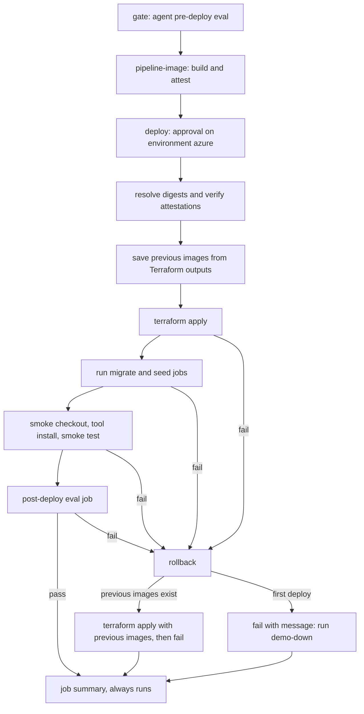

# vehicle-intelligence-platform

Terraform and GitHub Actions workflows that deploy three services to Azure Container Apps as a short-lived demo. The repository holds infrastructure and deploy automation only. Application code lives in its own repositories.

Azure deployment: not yet verified.

Try it now: the free, always-on MCP endpoint is `https://vehicle-mcp.chhlatbot.com/mcp`. It is not hosted by this repository.

## What it deploys

- Three services on Azure Container Apps: the data pipeline (internal ingress only), the MCP server, and the risk agent.
- Azure Database for PostgreSQL Flexible Server 16 with the pgvector extension, and two databases, `pipeline` and `agent`.
- Azure Key Vault holding the database URLs and other app secrets.
- An Azure OpenAI account with one `chat` model deployment, used by the agent.
- Four Container Apps jobs: pipeline migrate, pipeline seed, agent seed, and agent post-deploy eval.
- A monthly subscription budget that sends alerts (created by the bootstrap root).

The application repositories:

- [`vehicle-mcp-server`](https://github.com/sovorn-c/vehicle-mcp-server)
- [`vehicle-risk-agent`](https://github.com/sovorn-c/vehicle-risk-agent)
- [`nz-vehicle-data-pipeline`](https://github.com/sovorn-c/nz-vehicle-data-pipeline)

This repository is separate so that applications ship and are tested without cloud credentials, and so that the one place with permission to change Azure is small and reviewable. It consumes released, attested images from GHCR. It builds only the pipeline image, from a pinned commit of the pipeline repository, because that repository publishes none.

## Layout

| Path | Purpose |
| --- | --- |
| `terraform/bootstrap` | Applied once from a laptop with local state. Creates the Terraform state storage, the GitHub OIDC deployer identity, and the budget. |
| `terraform/stack` | Applied and destroyed by the workflows with remote state. Creates the network, Postgres, Key Vault, Azure OpenAI, the Container Apps environment, apps, and jobs. |
| `.github/workflows` | `ci.yml`, `pipeline-image.yml`, `demo-up.yml`, `demo-down.yml`. |
| `scripts` | `check.sh` (local preflight), `run-aca-job.sh` (start a job and wait for its result), `previous-images.sh` (read the last deployed images for rollback). |

## Deploy flow

`demo-up` is started by hand with the inputs `mcp_version`, `agent_version`, and `force_gate_failure`. Only the `deploy` job runs behind the `azure` environment, so there is one approval, and a rollback never waits on a person.

The smoke step runs `vehicle-mcp-server`'s `scripts/smoke-public.sh`, both the journey and `--security` modes, at `v<mcp_version>` against the MCP app's FQDN. It sets `PUBLIC_MCP_DIRECT_ORIGIN_HOST=none`, because on Azure the FQDN is the origin and there is no fronting edge to bypass. This opt-out needs `vehicle-mcp-server` 0.4.1 or later.

Rollback runs on any failure after apply starts, not only smoke or eval. Database migrations are not reversed, so old images may be re-applied over a partially run additive migration.

`demo-down` runs `terraform destroy` and then checks that the resource group no longer exists. It requires the input `confirm` to equal `destroy-azure-demo`.

## Security posture

- Azure login uses GitHub OIDC only. No cloud credential is stored in GitHub. The federated subject is `repo:sovorn-c/vehicle-intelligence-platform:environment:azure`, so only workflows in the `azure` environment can assume the deployer identity.
- The `AZURE_*` and `TFSTATE_*` values are environment variables, not secrets.
- Every image the stack accepts must be pinned by digest. Variable validation rejects tags and `latest` before anything is planned. Before apply, the workflow verifies the build attestation of all three images with `gh attestation verify`.
- Apps read secrets from Key Vault through user-assigned managed identities. Each identity has only the roles it needs: the MCP server reads no secrets, and only the agent can call Azure OpenAI. Azure OpenAI local key auth is disabled.
- Postgres has public network access disabled and is reachable only from the VNet through a private DNS zone.
- Every app and job is capped at one replica, and apps scale to zero when idle.
- The Terraform state account disallows shared keys and public blobs.

## Local validation

`scripts/check.sh` runs `terraform fmt -check`, `terraform init -backend=false` and `validate` for both roots, `tflint`, `terraform test` (mocked providers, no Azure access), `actionlint`, `shellcheck`, and the `tests/*.test.sh` scripts. It stops at the first failure.

Tools it needs on `PATH`: `terraform` 1.11 or later (the tests use `override_during`), `tflint`, `actionlint`, `shellcheck`, `bash`, and `jq`. `tflint --init` downloads the azurerm ruleset, so the first run needs network access. None of it needs an Azure account. CI runs the same script on every pull request and push to `main`.

## Deploy it yourself

1. **Prerequisites.** An Azure subscription where you hold Owner, the tools `terraform`, `az`, and `gh`, and a fork or copy of this repository. The defaults are `mcp_version` `0.4.1` (the `smoke-public.sh --security` fix) and `agent_version` `0.2.0` (the first `vehicle-risk-agent` release with the Azure contract). The apps pull images from GHCR without registry credentials, so all three packages must be public. The `vehicle-mcp-server` and `vehicle-risk-agent` packages are public. The pipeline package is not created until you dispatch the `pipeline-image` workflow, and its first push creates `vehicle-intelligence-platform/pipeline` as a private package. Make it public once, in the package settings on GitHub, before the first `demo-up`; until then Container Apps cannot pull it and `ca-pipeline` and the pipeline jobs fail to start. Later pushes keep the visibility.
2. **Fork limits.** A fork can deploy the published `ghcr.io/sovorn-c` app images, but it cannot publish its own pipeline image without code changes, because the workflows and validations are tied to the `sovorn-c` namespace and owner. To publish your own pipeline image, edit: the `IMAGE_NAME` namespace in `.github/workflows/pipeline-image.yml` (line 38); the `pipeline_image` validation in `terraform/stack/variables.tf` (line 23; lines 33 and 43 cover the MCP and agent images, which stay `sovorn-c`); and in `.github/workflows/demo-up.yml` the pipeline image check (line 113) and the `gh attestation verify --owner sovorn-c` loop (line 149), which uses one owner for all three images, so it needs a per-image owner. Without these edits, the pipeline image cannot be published from a fork.
3. **Cost.** The stack bills while it is up. The budget (default 25, set by `budget_amount`) only sends alerts. It does not cap spend. Run `demo-down` when you finish.
4. **Bootstrap, once.** Run `az login`, then `terraform -chdir=terraform/bootstrap init` and `terraform -chdir=terraform/bootstrap apply` with `budget_contact_email`, `budget_start_date` (the first day of the **current** month, for example `2026-10-01T00:00:00Z` when deploying in October 2026; a later month leaves the current month without alerts), and, if you fork, `-var="github_repository=<owner>/<repo>"` so the OIDC subject matches your fork from the first apply. Keep the local state file safe.
5. **GitHub environment.** Create the environment `azure` with yourself as required reviewer. Add one environment variable per bootstrap output, named as the output in upper case: `AZURE_CLIENT_ID`, `AZURE_TENANT_ID`, `AZURE_SUBSCRIPTION_ID`, `TFSTATE_RESOURCE_GROUP`, and `TFSTATE_STORAGE_ACCOUNT`.
6. **Deploy.** Run `demo-up` (override `agent_version` or `mcp_version` only if you need other releases), then approve the `deploy` job. The job summary shows the MCP URL. Terraform generates the four agent bearer tokens (`REQUESTER_TOKEN`, `REVIEWER_TOKEN`, `OPERATOR_TOKEN`, `MAINTAINER_TOKEN`) and `SNAPSHOT_INTEGRITY_SECRET` into Key Vault. If you replace any of them, keep the agent's production rules: no token may start with `dev-`, and `SNAPSHOT_INTEGRITY_SECRET` must be at least 32 characters, or the agent refuses to start.
7. **Tear down.** Run `demo-down` with `confirm = destroy-azure-demo`. Bootstrap and the budget stay. Remove them with `terraform -chdir=terraform/bootstrap destroy`.
